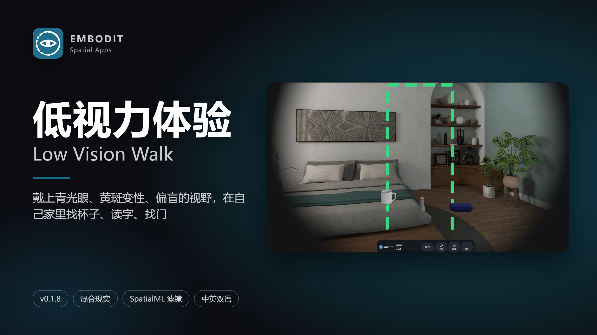
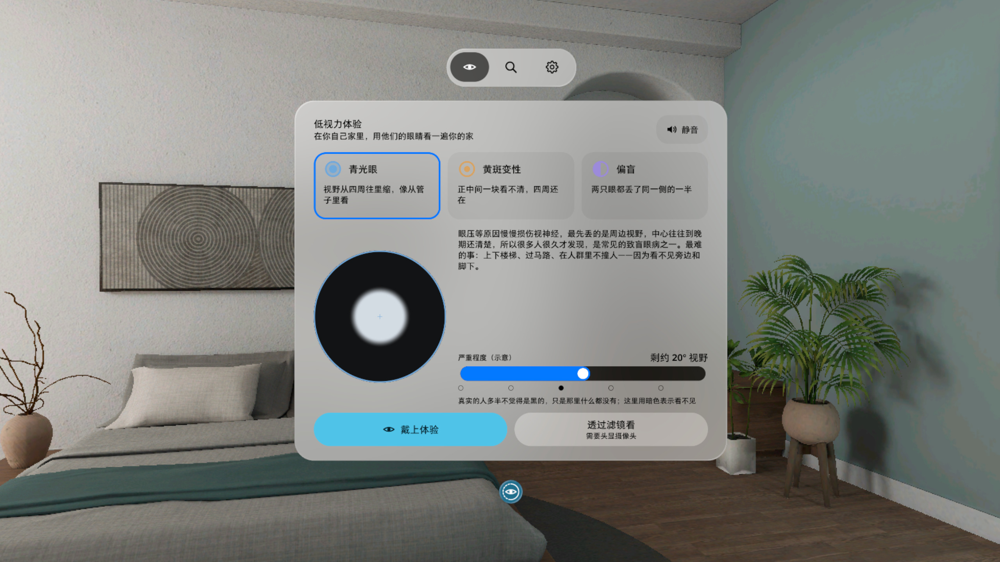
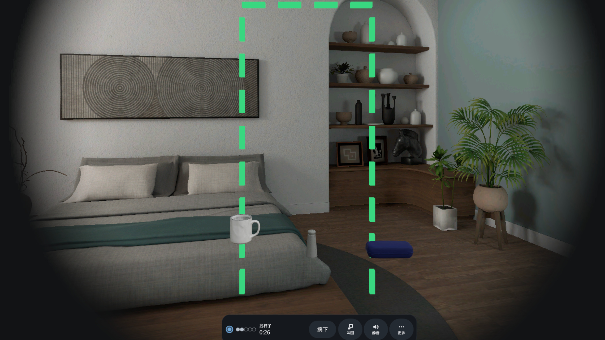
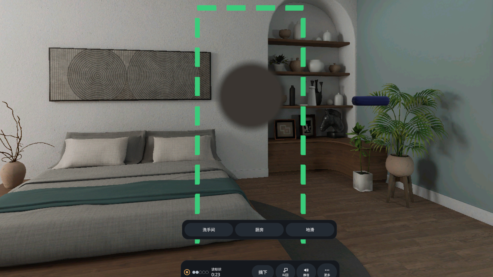
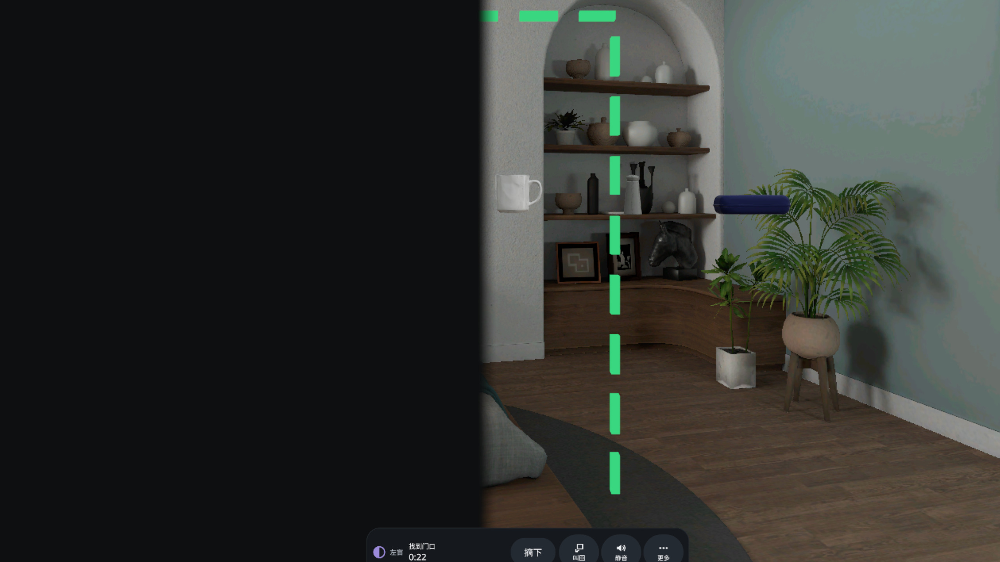
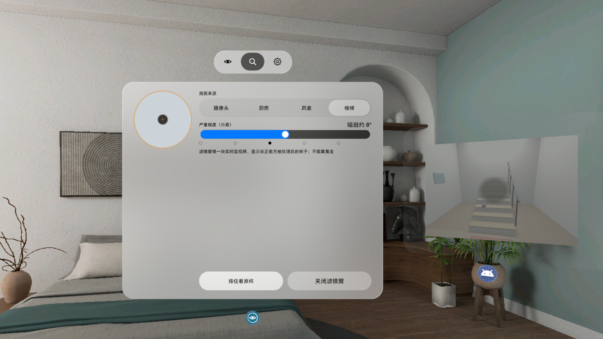
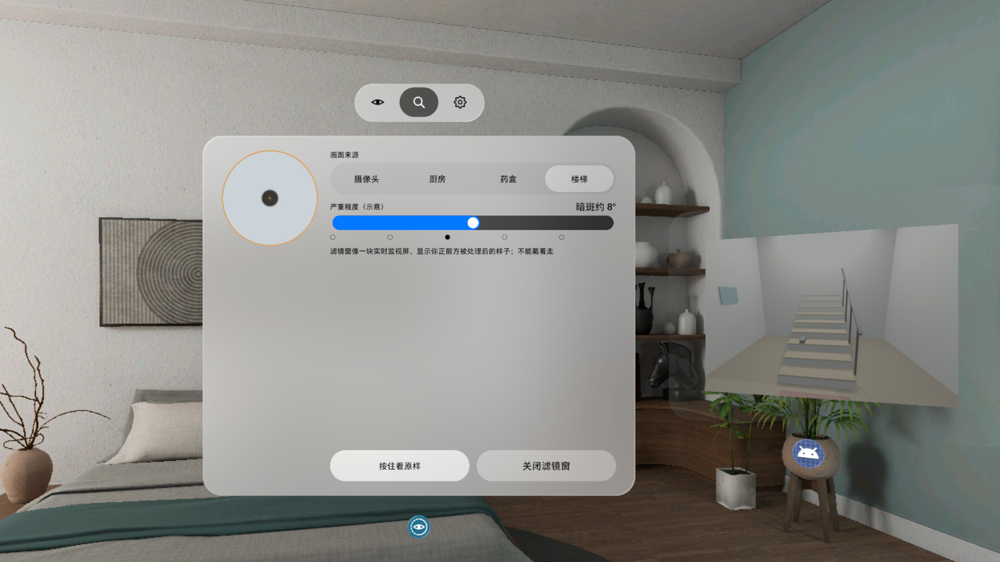

# 低视力体验 Low Vision Walk



**中文** · [English](#english)

在自己家里戴上青光眼的管状视野、黄斑变性的中心暗斑、偏盲的半边黑，原地找桌上的杯子、读墙上的字、指出门在哪（想走的话可以挑战走过去）；再透过 SpatialML 滤镜窗看房间被模糊、褪色成病人眼里的样子；最后拿到一张「家里怎么改」清单。

PICO OS 6 空间应用，Kotlin + PICO Spatial SDK 6.1.9，界面全部用 SpatialUI。版本 **v0.1.8**。

## 能做什么

- **选病种和严重程度**：青光眼（管状视野）、黄斑变性（中心暗斑）、偏盲（左 / 右半边看不见），5 档，示意图按度数画出。
- **戴上体验**：在透视的真实房间里戴上视野罩，原地做三件事：找杯子、读标识、找门口；可选挑战「戴着走到门口」，看不见的那一侧地上有只鞋。扫不到桌子 / 墙时用虚拟道具补上（Tripo 生成的桌子、马克杯、盐瓶、眼镜盒、标牌）。
- **滤镜窗**：用 SpatialML 把摄像头画面（或厨房 / 药盒 / 楼梯示例照片）过自己做的 LiteRT 滤镜模型，旁边窗口里看到处理后的样子；滤镜窗开着、画面出来后，首页的「按住看原样」才可以按。
- **家里怎么改**：6 条针对本病种的改造建议。
- 中英双语，离线，没有账号，不申请相机权限（SpatialML 安全模式，画面不回到应用）。

> 示意用，不是医学模拟，不能替代眼科诊断。

## 截图（v0.1.8，模拟器，中文界面）

| | |
|---|---|
|  首页：青光眼，剩约 20° 视野 |  戴上体验：管状视野下找杯子 |
|  读标识：中心暗斑挡住字，下方选词 |  找门口：左侧偏盲 |
|  滤镜窗：楼梯照片过黄斑滤镜 |  按住看原样：同一张照片不加滤镜 |

演示视频见 [Release v0.1.8](https://github.com/kejing-dev/LowVisionWalk/releases/tag/v0.1.8)（`video-01.mp4`）。**非真实手势录像**：模拟器上用调试广播驱动，录屏约 1 fps，有卡顿感。

## 安装

```bash
adb install -r LowVisionWalk-v0.1.8.apk
pico-cli app launch io.embodit.lowvision
```

APK 在 [Releases](https://github.com/kejing-dev/LowVisionWalk/releases)。调试签名；装过其他电脑构建的版本时先 `adb uninstall io.embodit.lowvision`。

## 构建

```bash
./gradlew assembleDebug
```

需要 JDK 21 和 Android SDK 35。调试命令和 QA 状态清单见 [AGENTS.md](AGENTS.md)。

## 已知问题（v0.1.8）

- v0.1.8 没有跑模拟器 QA（上一轮 QA #4 测的是 v0.1.5）；用户在头显上试过滤镜窗用 × 关闭再打开、按住看原样，不再闪退。研发站的「每个入口开 → 关 → 再开，两轮」头显脚本 v0.1.8 没跑完（用户当时戴着头显）。
- 任务 / 扫描中按「回首页」，模拟器高负载时首页窗可能被系统启动器盖住（QA #4）。
- 低头看桌时药丸条会压在桌上物品前面；挑战用的鞋可能在虚拟桌底下（QA #3 / #4）。
- 重开的窗口中心在视线上，不是略低于视线：系统窗口应用设不了位姿。
- 摄像头滤镜只在真机上有画面；SpatialML 容器在 Full Space 下会被隐藏，所以滤镜窗不能戴着走。

---

<a id="english"></a>

## English

Put on the tunnel vision of glaucoma, the central blind spot of macular degeneration or the half-field loss of hemianopia in your own home, then find the mug on the table, read the sign on the wall and point at the door (or try walking there). Look through the SpatialML lens window to see your room blurred and faded the way a patient sees it, and finish with a "what to change at home" checklist.

PICO OS 6 spatial app, Kotlin + PICO Spatial SDK 6.1.9, all UI in SpatialUI. Version **v0.1.8**.

- **Pick a condition and a severity**: glaucoma, AMD, hemianopia (left / right), 5 steps, drawn in degrees.
- **Walk with the veil**: three in-place tasks (find the mug, read the sign, find the door) plus an optional walk-to-the-door challenge with a shoe on your blind side. Missing furniture is filled in with Tripo-made props.
- **Lens window**: SpatialML runs the camera feed (or a kitchen / pill box / stairs photo) through our own LiteRT filter model. "Hold to see original" on the home window works only while the lens window is open and its picture is up.
- Chinese and English, offline, no account, no camera permission (SpatialML secure mode).

> Illustrative only, not a medical simulation.

Install: `adb install -r LowVisionWalk-v0.1.8.apk`, then `pico-cli app launch io.embodit.lowvision`. The demo video on the release page is **not a real hand recording**: it is driven by debug broadcasts on the emulator (about 1 fps).

Known issues: v0.1.8 was not run through emulator QA (QA #4 covered v0.1.5) and the two-round reopen script did not finish on the headset; see the Chinese list above.

Fonts: Noto Sans / Noto Sans SC (SIL OFL 1.1, `third_party/`).
